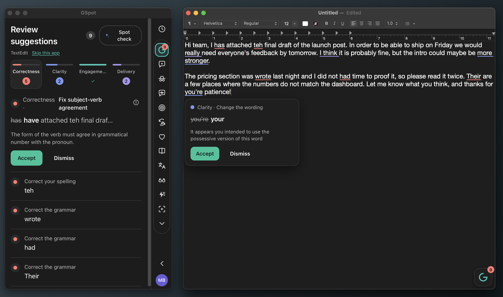

# GSpot



A local-first, open-source Grammarly-style writing assistant for macOS and Linux. On macOS, a floating panel
docked to the left edge follows the text field you are typing in and underlines issues in place. On Linux,
GSpot reviews copied text through the clipboard. Both run the full sidebar of tools: suggestions, AI chat, plagiarism, tone, performance score,
paraphraser, humanizer, reader reactions, translate, explain it, AI rewriter, AI detector.

On macOS the panel starts **tucked**: a small G tab sits flush with the left screen edge. Click the tab and the
panel slides out; the red close button or the "Tuck away" chevron at the bottom of the rail slides it back.
Linux opens the panel initially to explain its clipboard workflow.

* Correctness engine: [Harper](https://writewithharper.com) (`harper-core`, in-process, offline).
  A sentence over 40 words gets a "Split the long sentence" card with a lossless split ready to accept;
  the spot check (the model) replaces it with a better split when one passes the guards.
* Text access: macOS uses the Accessibility API (focused field, selection, `AXBoundsForRange` geometry).
  Linux uses a safe clipboard workflow: copy text in any app, review it in GSpot, then accept a fix to copy
  the replacement and paste it over the original selection. This works on X11 and Wayland without privileged
  synthetic input. Native focused-field overlays are currently macOS-only.
  Terminals (Terminal, iTerm2, Warp, Ghostty, kitty, Alacritty, WezTerm, Hyper) are skipped: a shell
  transcript is not writing. Any other app can be skipped from the Review view ("Skip this app") and
  turned back on under Settings → Skipped apps.
* Replacements: macOS uses AX selected-text set, then a verified pasteboard patch fallback. Linux copies the
  accepted replacement so you can paste it over your original selection.
* AI features: **publik API** by default (no account, no key: the app mints its own key on this
  computer after a two-sentence disclosure; you sign in with publik to add free use or a plan),
  or your own key (paste it; OpenAI, Anthropic, OpenRouter, Groq and Google are detected from the
  prefix and a model is picked for you). URLs, ports and model names sit under "Advanced". There
  is no local-model option; only the e2e rig points the app at Ollama, through the debug probe.
* Spot check: sentence-level suggestions (make it concise, active voice, rephrase for clarity,
  remove a repeated or filler sentence) from the model, guarded so numbers, names and quotes
  survive and clean prose is left alone. See `docs/SPOTCHECK.md`.
* Plagiarism: web search through publik API when it is on (`POST /search`, one cent a search), your
  own Brave Search API key if you paste one in Settings, else a keyless chain (Brave HTML, Bing,
  DuckDuckGo); 7-gram overlap, APA/MLA/Chicago citations.

See `docs/REVERSE-ENGINEERING.md` for what was learned from Grammarly Desktop and `docs/PLAN.md` for the gates.

## Install

GSpot is listed on [publik](https://publikhq.com/gspot).

### macOS

1. Download `GSpot_<version>_aarch64.dmg` from the [latest GitHub release](https://github.com/Blueturboguy07/gspot/releases/latest) (Apple silicon Macs).
2. Open the dmg and drag GSpot to Applications.
3. Open GSpot. The app is signed with a Developer ID and notarized by Apple, so macOS opens it without a warning.
4. Grant Accessibility when asked, under System Settings, Privacy & Security, Accessibility.

### Linux (beta)

Install the release `.deb` on Debian/Ubuntu, or use the AppImage on other distributions. Open GSpot, copy the
text you want reviewed, then accept a suggestion and paste the copied replacement back into the original editor.
No accessibility permission is required. The Linux workflow is supported on X11 and Wayland; global underlines,
focused-field tracking, and direct replacement are currently macOS-only.

GSpot lives in the menu bar and as a tab on the left screen edge. AI features run through publik API by
default; the first use shows a two-sentence disclosure and mints a key for this computer.

## Build

```bash
bun run setup       # installs the UI dependencies with Bun
bun run dev         # hot reload: Vite + the app
# signed release (.app + .dmg)
scripts/build-debug.sh                   # debug build with the publik app token compiled in (for the e2e gates)
scripts/build-macos.sh --skip-notarize   # or with NOTARY_PROFILE / APPLE_ID+APPLE_PASSWORD+APPLE_TEAM_ID
scripts/verify-macos.sh                  # codesign, Gatekeeper, launch
# Linux (.deb + AppImage; see dependencies below)
scripts/build-linux.sh
```

Grant Accessibility to GSpot once (System Settings → Privacy & Security → Accessibility).
The publik app token is read from `PUBLIK_APP_TOKEN` or `~/.publik/gspot-app-token` at build
time (minted with publik's `scripts/mint-app-token.mts gspot`); a build without it still
offers your own key. `PUBLIK_SELF_TEST=1 /Applications/GSpot.app/Contents/MacOS/grammarlama` prints one
line that proves the publik API wiring of a built app.

## Test

```bash
bun run test                               # TypeScript unit tests
cd src-tauri && cargo test                 # Rust unit tests (engine, score, phrases, plagiarism, …)
tests/e2e/host_textedit.sh                 # reads/lints/fixes a real TextEdit document through AX (incl. a spot-check accept)
tests/e2e/features.sh                      # every LLM/web feature against the rig's Ollama + the live web
tests/e2e/spotcheck.sh                     # the 14-document spot-check corpus through the app (>= 90 % to pass)
tests/tuning/live_corpus.sh                # the same corpus through the pipeline alone (no app windows)
tests/e2e/setup.sh                         # publik API provisioning, own-key probe, the rig's Ollama
```

The e2e scripts launch the debug binary with `GRAMMARLAMA_DEBUG_PORT=47331` and talk to a loopback
probe (`/state`, `/accept`, `/feature`, `/lint`). `start_app` then points the app at the rig's Ollama
(`qwen2.5:7b`, or `E2E_MODEL`) through the probe, because the product itself offers no local model;
`E2E_KEEP_LLM=1` runs the gates on whatever the app is set to. A debug (`cargo build`) binary loads the Vite dev
server, which the harness starts for you. To test the signed bundle instead:

```bash
APP_BIN=src-tauri/target/release/bundle/macos/GSpot.app/Contents/MacOS/grammarlama tests/e2e/host_textedit.sh
```

Accessibility trust: a binary launched from a terminal inherits the terminal's grant (macOS charges
the "responsible process"). Launched from Finder, GSpot asks for its own grant once.

### Linux build dependencies

On Ubuntu/Debian:

```bash
sudo apt install build-essential pkg-config libwebkit2gtk-4.1-dev libgtk-3-dev libayatana-appindicator3-dev librsvg2-dev
scripts/build-linux.sh
```

Build on the intended Linux architecture. Tauri's WebKitGTK dependency and package bundling are native, so the
release build is not designed to cross-compile from macOS.
